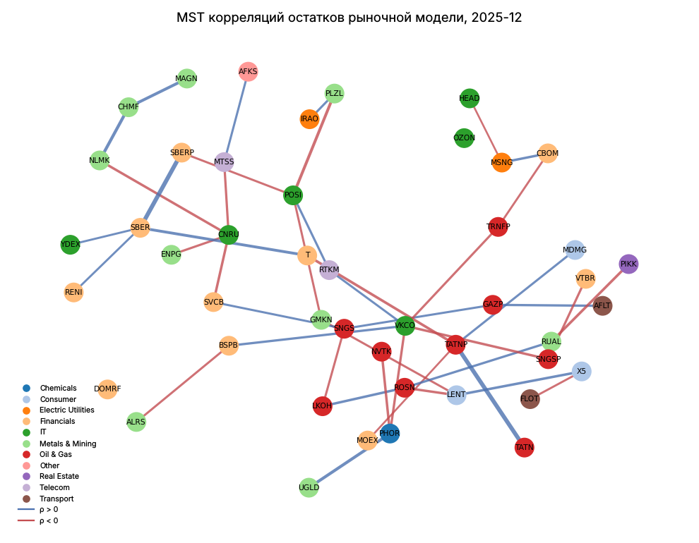
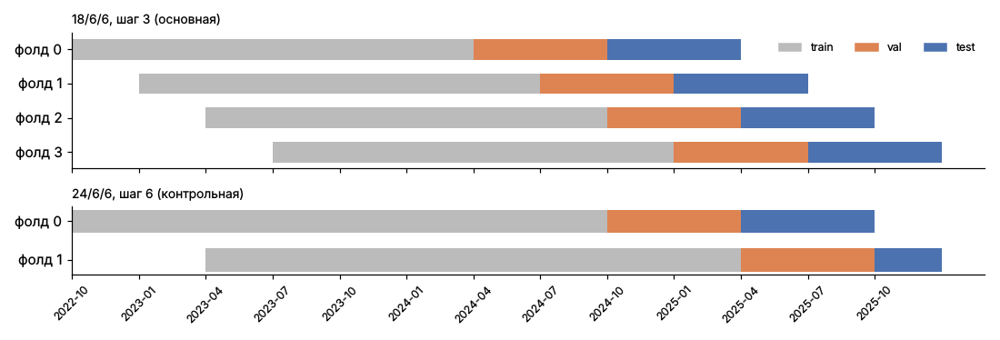
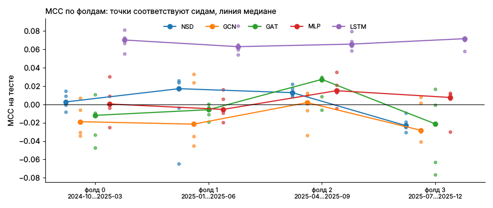
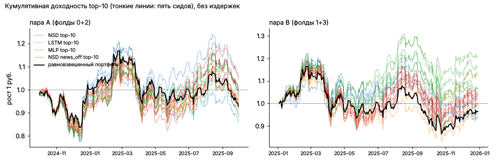

# Прогноз направления дневной доходности акций IMOEX

**Новости Telegram (ruBERT) + динамический граф эмитентов + Neural Sheaf Diffusion**

Курсовая работа · экономический факультет МГУ им. М. В. Ломоносова · Корякин Даниил · 2025–2026

---

## Коротко

End-to-end пайплайн: 46 бумаг индекса IMOEX с августа 2022 по декабрь 2025, 22 тыс. новостей
из трёх Telegram-каналов, привязанных к эмитентам и векторизованных ruBERT, динамический
знаковый граф корреляций и графовая модель на аппарате клеточных пучков (Neural Sheaf
Diffusion, Bodnar et al., 2022). Сравнение с пятью бейзлайнами на walk-forward валидации
(четыре фолда, пять сидов, одинаковые батчи и бюджет оптимизации у всех архитектур), тесты
значимости с бутстрэпом по дням и бэктест.

| Модель | MCC (4 фолда × 5 сидов) |
|---|---:|
| LSTM, только цены и объёмы | **+0,068 ± 0,004** |
| MLP / NSD / GAT / GCN | +0,004 / +0,002 / −0,003 / −0,017 |
| NSD без новостей / MLP без новостей | +0,032 ± 0,023 / +0,032 ± 0,026 |

Результат отрицательный и воспроизводимый: на однодневном горизонте ни граф, ни новости не
дают сигнала сверх того, что уже есть в ценах, а новости в текущей привязке его ухудшают.
Единственный устойчивый эффект: предсказуемость знака доходности по 20-дневному окну цен
и объёмов, и он не переживает транзакционных издержек. Весь анализ умещается в четыре
ноутбука; обучение воспроизводится на CPU побитово примерно за час.

---

## Задача

Трёхклассовая классификация знака доходности акции на следующий торговый день:
`DOWN` / `FLAT` / `UP` по терцилям, рассчитанным для каждого тикера на train-части фолда.
Метрика: MCC, коэффициент корреляции Мэтьюса. Доли классов на тесте сдвигаются вместе с рынком,
поэтому accuracy не различает модели (мажоритарный класс даёт 0,385, больше любой модели),
а MCC равен нулю для любого вырожденного предсказания.

Три гипотезы:

* **H1**: sheaf-структура на знаковом графе даёт прирост над GCN и GAT;
* **H2**: ruBERT-эмбеддинги новостей улучшают прогноз;
* **H3**: стратегия long-only top-10 на сигналах модели обыгрывает пассивный портфель.

---

## Данные

| | |
|---|---|
| Котировки | MOEX ISS API, 46 бумаг IMOEX, 873 торговых дня, 35 754 строки OHLCV; цены скорректированы на сплиты и консолидации (TRNFP 1:100, GMKN 1:100, VTBR 5000:1, PLZL 1:10) |
| Новости | Telethon, каналы `bcs_express`, `RBCinvest`, `smartlabnews`: 23 027 сообщений → 22 345 после дедупликации |
| Привязка к тикерам | каскад: явное упоминание эмитента (42,6 % новостей, вес 1) → отраслевое слово (13,3 %, вес 0,5) → весь индекс (44,0 %, вес 0,2); на последний уровень приходится 90 % связей |
| Признаки узла | 775 = доходности дней t, t−1, …, t−4 + log-объём к 20-дневному среднему + флаг новостей + 768 ruBERT (взвешенное среднее по привязанным новостям) |
| Граф | минимальное остовное дерево на корреляциях остатков рыночной модели `r_i = a_i + b_i m + e_i` за 60 дней; пересчёт раз в месяц; доля отрицательных рёбер 0,52 (0,43–0,66) |

Привязка ищет синонимы с границей слова и с учётом склонений, привилегированные акции получают
новости обыкновенных, а упоминания индексов, биржи как площадки («торги на Мосбирже»), ссылок
и соцсетей перед поиском вырезаются. Секторы берутся из отраслевых индексов Мосбиржи (`MOEXOG`,
`MOEXFN`, `MOEXIT`, `MOEXTN` и др.).

Защита от утечки будущего: новости после 18:50 МСК относятся к следующей сессии, новости выходных
и праздников — к ближайшей следующей; пороги разметки, скейлеры и веса классов считаются только
на train фолда; граф месяца строится на конце предыдущего месяца; последний день train и val
выбрасывается, потому что его таргет заглядывает в следующий сплит; доходность через пропуск
торговой сессии не считается.

<p align="center"></p>

Два свойства данных, важных для интерпретации: флаг `has_news` равен единице на 99,9 % строк,
а 64,3 % дисперсии новостного эмбеддинга приходится на общее для всех бумаг состояние дня (следствие
широковещательной привязки). Новости здесь в основном индикатор рынка, а не отдельной бумаги.

**Ограничения данных.** Состав индекса взят на декабрь 2025 года (survivorship bias). Публичный
MOEX ISS не отдаёт дивиденды без авторизации, поэтому доходности ценовые: скорректированы на сплиты,
но не на дивиденды; в дни отсечки таргет и бэктест занижены на размер дивиденда. Секторы взяты
по составу отраслевых индексов на момент пересборки (октябрь 2026); PIKK, выпавший из `MOEXRE`,
вручную отнесён к Real Estate.

---

## Модель и бейзлайны

Sheaf-диффузия заменяет скалярный вес ребра парой матриц `d × d`. Слой в формулировке
Bodnar et al. (2022): `X ← (1 + tanh ε) X − σ(Δ_F (I ⊗ W₁) X W₂)`, где `Δ_F = D^{-1/2} L_F D^{-1/2}` —
нормированный пучковый лапласиан, `(L_F x)_v = Σ_e F_{v◁e}ᵀ (F_{v◁e} x_v − F_{u◁e} x_u)`, а карты
ограничения `F_{v◁e}` предсказывает MLP по концам ребра и его знаку. Сам лапласиан положительно
полуопределён, но его внедиагональные блоки `−F_{v◁e}ᵀ F_{u◁e}` знаконеопределены: диффузия может
не только сглаживать соседей, как GCN, но и «разводить» их на отрицательных рёбрах. Архитектура:
`Linear(775 → 64)` → два слоя диффузии (`d = 4`) → `Linear(64 → 3)`, 69 253 параметра.

Бейзлайны на тех же фолдах: GCN и GAT на тех же признаках и графе, MLP на тех же признаках
без графа, LSTM на 20-дневном окне цен и объёмов без новостей и графа, мажоритарный класс.
Все модели обучаются одним циклом: батч из 10 торговых дней, склеенных в один несвязный граф,
AdamW, early stopping по валидационному MCC, не более 100 эпох. Рёбра к бумагам, которые в этот
день не торговались, из графа дня выбрасываются.

Валидация: walk-forward по месяцам, сетка 18/6/6 с шагом 3, четыре фолда с шестимесячными
тестовыми окнами (с октября 2024 по декабрь 2025), пять сидов на конфигурацию. Бумаги, у которых
в train фолда меньше 120 строк (новые тикеры после редомициляции и IPO: T, HEAD, X5, YDEX, CNRU,
DOMRF), не размечаются: терцилей для них нет; размечено 88–90 % тестовых строк. Оценка: медиана
по сидам внутри фолда, среднее ± отклонение по фолдам.

<p align="center"></p>

---

## Результаты

Тестовые окна соседних фолдов пересекаются на три месяца, поэтому тесты значимости считаются на
двух непересекающихся парах фолдов (A = 0 + 2, B = 1 + 3), отдельно по каждому сиду, с блочным
бутстрэпом по дням (строки одного дня зависимы через общий рынок). «Значимо» — только если на 5 %
согласны все пять сидов.

### Модели

| Модель | MCC | по фолдам | IC | Macro-F1 |
|---|---:|---:|---:|---:|
| LSTM (цены и объёмы) | **+0,068 ± 0,004** | +0,063 … +0,072 | +0,029 | 0,352 |
| MLP | +0,004 ± 0,009 | −0,005 … +0,015 | +0,027 | 0,322 |
| NSD | +0,002 ± 0,018 | −0,023 … +0,017 | +0,011 | 0,317 |
| GAT | −0,003 ± 0,021 | −0,021 … +0,027 | +0,002 | 0,312 |
| GCN | −0,017 ± 0,013 | −0,028 … +0,002 | +0,002 | 0,309 |
| Majority | 0,000 | | | 0,185 |

<p align="center"></p>

NSD, GCN, GAT и MLP неотличимы ни от нуля, ни друг от друга: в бутстрэпе ΔMCC знак меняется от
сида к сиду на обеих парах. LSTM значимо лучше и NSD, и MLP на обеих парах при всех сидах
(ΔMCC от −0,06 до −0,09), и только у LSTM направленный тест Пезарана-Тиммерманна значим (UP на
обеих парах, DOWN на паре B). Преимущество LSTM не сводится к доступу к доходности дня t: она
есть и в признаках остальных моделей.

### Абляции

| Конфигурация | MCC | по фолдам |
|---|---:|---:|
| **NSD без новостей** | **+0,032 ± 0,023** | +0,009 … +0,057 |
| **MLP без новостей** | **+0,032 ± 0,026** | +0,006 … +0,056 |
| NSD базовая (d = 4, L = 2, corr-MST, с новостями) | +0,002 ± 0,018 | −0,023 … +0,017 |
| NSD L = 1 / L = 3 | +0,006 / −0,002 | |
| NSD d = 2 / d = 8 (ширина 64) | +0,006 / +0,002 | |
| NSD на секторном графе | +0,005 ± 0,015 | −0,017 … +0,018 |

Отключение новостей улучшает NSD во всех четырёх фолдах и даёт тот же прирост у MLP. По строгому
критерию (значимо при всех сидах) эффект незначим, но его знак устойчиво противоположен H2 и не
зависит от архитектуры. Размерность стебля, глубина и тип графа ничего не меняют.

### Бэктест

Long equal-weight из десяти бумаг с наибольшим `P(UP) − P(DOWN)`, дневная ребалансировка.
Бенчмарк: равновзвешенный портфель всех размеченных бумаг; медиана по сидам.

| Пара фолдов | NSD | NSD без новостей | MLP | LSTM | GCN | GAT | равновзвешенный |
|---|---:|---:|---:|---:|---:|---:|---:|
| A: 2024-10 … 2025-09, без издержек | −6,9 % | −0,8 % | −2,2 % | −6,1 % | −7,2 % | −4,6 % | −7,3 % |
| A: при 5 б.п. round-trip | −14,9 % | −8,7 % | −10,7 % | −12,8 % | −15,5 % | −13,1 % | |
| B: 2025-01 … 2025-12, без издержек | −1,2 % | +3,7 % | +13,7 % | −0,1 % | −3,1 % | −3,1 % | −3,6 % |
| B: при 5 б.п. round-trip | −9,6 % | −4,9 % | +4,0 % | −6,6 % | −11,5 % | −11,8 % | |

<p align="center"></p>

Без издержек большинство стратегий обгоняет бенчмарк; с заметным отрывом на обеих парах — MLP
(+5,0 и +17,3 п. п. активной доходности) и NSD без новостей (+6,4 и +7,2 п. п.). Оборот 49–73 %
портфеля в день: при 5 б.п.
round-trip бенчмарк обгоняет только MLP на паре B (+7,6 п. п.), на паре A он проигрывает.
Лучший MCC у LSTM не даёт лучшей доходности. Ни одна стратегия не обыгрывает депозит при ключевой
ставке 16–21 %.

### Чувствительность к сетке валидации

NSD на контрольной сетке из двух длинных фолдов (24/6/6, шаг 6) даёт +0,038 при разбросе
по сидам от +0,021 до +0,063; на четырёх фолдах +0,002. Разброс по сидам внутри одного фолда
(до 0,09) сопоставим с разницей между лучшей и худшей моделью: оценка по одному сиду и двум
фолдам могла бы показать любое значение из этого диапазона. Отсюда протокол: медиана по пяти
сидам, среднее по четырём фолдам, тесты на непересекающихся парах фолдов.

---

## Выводы

| | Гипотеза | Статус |
|---|---|---|
| H1 | sheaf-структура даёт прирост над GCN/GAT | не подтверждается: NSD неотличим от GAT и MLP, разница с GCN незначима |
| H2 | новости улучшают прогноз | не подтверждается: без новостей лучше у NSD и у MLP |
| H3 | стратегия обыгрывает пассивный портфель | не подтверждается: после издержек — только MLP на одной паре из двух |

Что из этого следует. Потолок задачи определяет сигнал в данных, а не архитектура: ни
пучковый оператор, ни перебор гиперпараметров не сдвигают MCC графовых моделей от нуля.
Новости в текущей привязке работают как общерыночный индикатор с 90 % широковещательных связей
и мешают моделям. Направления, которые имеют смысл: горизонт таргета в 5–20 дней (чтобы сигнал
переживал издержки), рост доли явных привязок новостей (NER вместо словаря), полная доходность
с дивидендами, динамический состав индекса и история с 2018 года.

---

## Структура репозитория

```
00_build_data.ipynb   сбор и подготовка данных: MOEX ISS, Telegram, привязка, ruBERT, признаки, граф → data/
01_data.ipynb         профиль данных и графа → figures/
02_experiments.ipynb  модели, walk-forward CV, 270 прогонов → results/
03_results.ipynb      таблицы, тесты значимости, бэктест → results/, figures/
figures/              графики из этого README
requirements.txt      зависимости
```

Папки `data/` и `results/` создаются ноутбуками локально и в репозиторий не входят: сырые
данные весят сотни мегабайт, а метрики и предсказания пересчитываются из них.

## Воспроизведение

```bash
uv venv --python 3.12 .venv
uv pip install --python .venv/bin/python -r requirements.txt
.venv/bin/jupyter nbconvert --to notebook --execute --inplace 00_build_data.ipynb   # данные: сеть, Telegram API, GPU для ruBERT
.venv/bin/jupyter nbconvert --to notebook --execute --inplace 01_data.ipynb
.venv/bin/jupyter nbconvert --to notebook --execute --inplace 02_experiments.ipynb  # ≈ 1 час на CPU
.venv/bin/jupyter nbconvert --to notebook --execute --inplace 03_results.ipynb
```

Ноутбук 00 собирает `data/` с нуля: котировки и сплиты с MOEX ISS без ключей, новости через
Telegram API (переменные `TELEGRAM_API_ID`, `TELEGRAM_API_HASH`, `TELEGRAM_PHONE` в файле `.env`),
эмбеддинги ruBERT лучше считать на GPU/MPS. Если `data/tickers.csv` уже есть, состав индекса берётся
из него, а не загружается заново. Новостной корпус и составы отраслевых индексов зависят от момента
выгрузки, поэтому при пересборке данных числа могут отличаться от приведённых. Обучение в 02 идёт
на CPU в один поток и при одинаковых данных воспроизводится побитово.

## Стек

Python · PyTorch · PyTorch Geometric · transformers (ruBERT) · scikit-learn · pandas · NumPy ·
SciPy · matplotlib · NetworkX · Telethon · MOEX ISS API

## Литература

* Bodnar C., Di Giovanni F., Chamberlain B., Liò P., Bronstein M. *Neural Sheaf Diffusion: A Topological Perspective on Heterophily and Oversmoothing in GNNs.* NeurIPS, 2022.
* Hansen J., Ghrist R. *Toward a Spectral Theory of Cellular Sheaves.* J. Appl. Comput. Topology, 2019.
* Mantegna R. N. *Hierarchical Structure in Financial Markets.* Eur. Phys. J. B, 1999.
* Diebold F. X., Mariano R. S. *Comparing Predictive Accuracy.* J. Business & Economic Statistics, 1995.
* Pesaran M. H., Timmermann A. *A Simple Nonparametric Test of Predictive Performance.* J. Business & Economic Statistics, 1992.
* Künsch H. R. *The Jackknife and the Bootstrap for General Stationary Observations.* Annals of Statistics, 1989.
* Куратов Ю., Архипов М. *Adaptation of Deep Bidirectional Multilingual Transformers for Russian Language.* Диалог, 2019.
